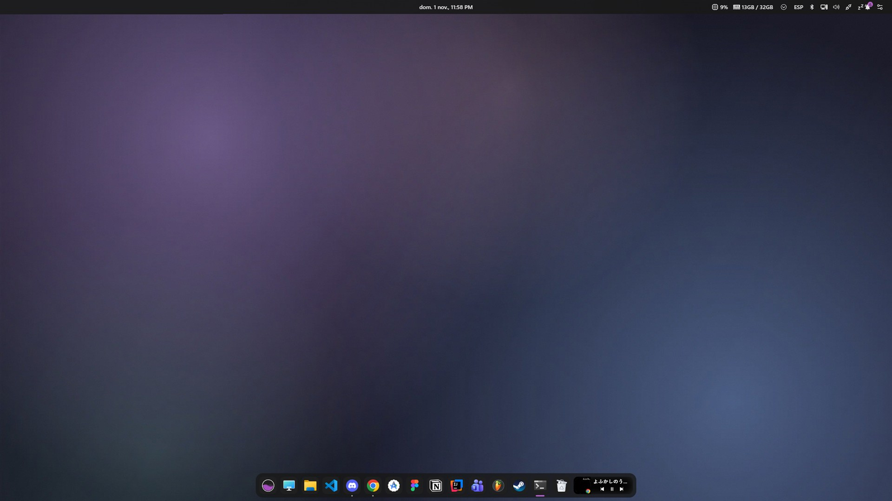

<div align="center">

# 🍚 windows-rice

**Windows 11 con dock y barra tipo Mac, terminal de programador y un lanzador rápido, en un solo comando.**

`Seelen UI` · `Flow Launcher` · `PowerToys` · `Everything` · `Windows Terminal` · `Starship`

Paleta **Catppuccin Mocha** en todo · se instala con un script · se quita con otro

</div>



---

## ⚡ Instalar (1 minuto)

Abre **PowerShell** y pega:

```powershell
powershell -NoProfile -ExecutionPolicy Bypass -Command "irm https://raw.githubusercontent.com/PauLopNun/windows-rice/main/get.ps1 | iex"
```

Pedirá permisos de administrador, descargará el pack a `%USERPROFILE%\windows-rice`, instalará todo y lo dejará configurado. **No tienes que tocar nada más.**

<details>
<summary>Me da error («acceso denegado», «la ejecución de scripts está deshabilitada»…)</summary>

1. Usa **exactamente** el comando de arriba (lleva `-ExecutionPolicy Bypass`): Windows trae por defecto los scripts bloqueados y sin eso falla.
2. Si no se abre el aviso de administrador: clic derecho en Inicio → **Terminal (Administrador)** y pega el comando ahí.
3. Si aun así falla: descarga el ZIP del repo (*Code → Download ZIP*), descomprímelo y ejecuta dentro de la carpeta, en PowerShell como administrador:
   `powershell -NoProfile -ExecutionPolicy Bypass -File .\install.ps1`
4. Si el antivirus bloquea algo, añade una excepción para la carpeta `%USERPROFILE%\windows-rice` y repite.
5. Si algo no se ve bien (dock, barra, iconos), ejecuta el diagnóstico (solo lee, no cambia nada, copia el resultado al portapapeles y quita tu usuario) y pégalo en el *issue*:
   `irm https://raw.githubusercontent.com/PauLopNun/windows-rice/main/diagnose.ps1 | iex`
6. Si la barra superior de Seelen no tiene los módulos del pack (energía, CPU/RAM…) o están en otro orden, repárala (hace copia de la tuya y reinicia Seelen; con `-ResetDock` reconstruye también el dock):
   `irm https://raw.githubusercontent.com/PauLopNun/windows-rice/main/repair-seelen.ps1 | iex`

Si sigue fallando, copia el mensaje de error **completo** (la línea roja entera) y abre un *issue* en el repo.
</details>

<details>
<summary>¿Prefieres no ejecutar un one-liner? Instalación manual</summary>

1. Descarga el ZIP del repo (*Code → Download ZIP*) y descomprímelo.
2. PowerShell **como administrador**, dentro de la carpeta:

```powershell
powershell -ExecutionPolicy Bypass -File .\install.ps1
```
</details>

### Opciones

| Opción | Efecto |
|---|---|
| `-NoSeelen` | **Modo ligero**: sin dock ni barra (Seelen es lo que más RAM gasta, ver abajo) |
| `-NoCli` | Sin Git, zoxide, fzf, lazygit ni fastfetch |
| `-NoCursor` | No cambia el cursor del ratón |
| `-NoTweaks` | No toca modo oscuro, extensiones ni botones de la barra |
| `-NoLaunch` | No abre las apps al terminar |
| `-SkipRestorePoint` | No crea punto de restauración (Windows solo permite uno cada 24 h) |

Es **idempotente**: puedes repetirlo y salta lo que ya está hecho. Si ya tenías alguna app, **no la toca** y el desinstalador **no la quita**.

## ✨ Qué incluye

| | |
|---|---|
| 🖥️ **Seelen UI** | Dock y barra superior estilo macOS con CPU y RAM. Arranca con Windows. En la barra tienes el **icono de volumen** (rueda del ratón = subir/bajar el volumen general; clic = su mezclador) y en el dock los controles de lo que suena (anterior, pausa, siguiente). Su capa de fondos propia viene **desactivada** para que se vea el fondo de Windows y ahorrar GPU/RAM |
| 🚀 **Flow Launcher** | `Alt+Espacio` abre apps, archivos, calcula y busca en la web. Tema Catppuccin Mocha. Busca archivos con **Everything** (instantáneo) |
| 🔌 **Plugins de Flow** | Clipboard+ → `cbp` · Emoji → `e <nombre>` · Windows Settings → `s <ajuste>` · Window Walker y Colors funcionan al escribir directamente |
| 🧰 **PowerToys** | Cuentagotas, copiar texto de imágenes, vista previa con Espacio, FancyZones, PowerRename… Arranca con Windows. Vienen **desactivados** los módulos que vigilan el ratón siempre (Find My Mouse, Mouse Highlighter) y Shortcut Guide |
| 🔎 **Everything** | Búsqueda instantánea de archivos; Flow la usa por debajo (por eso arranca con Windows) |
| 💻 **Terminal** | Catppuccin Mocha, JetBrainsMono Nerd Font, PowerShell 7 y prompt **Starship** |
| 🛠️ **CLI** | Git, zoxide (`z carpeta`), fzf, lazygit, fastfetch |
| 🖱️ **Cursor** | [Bibata](https://github.com/ful1e5/Bibata_Cursor) Modern Classic (negro, redondeado). Se descarga al instalar y al desinstalar vuelve el tuyo |
| 🖼️ **Fondo** | Degradado oscuro Catppuccin generado para este repo |
| 🌙 **Windows** | Modo oscuro, extensiones de archivo visibles, sin botón de chat ni de vistas (el de widgets lo protege Windows 11) |
| 🔎 **Comprobación final** | Al terminar, el instalador comprueba la barra superior de Seelen contra la del pack y, si Seelen la ha cambiado, la restaura solo |
| ⚡ **Autoarranque** | Seelen, Flow, Everything y PowerToys arrancan con Windows; se abre todo al terminar |
| 🧼 **Escritorio limpio** | Los accesos directos que dejan los instaladores en el escritorio se borran (solo los nuevos; los tuyos no se tocan) |

## 📊 Rendimiento

Medido en un PC con 32 GB y **dos monitores** (memoria privada):

| App | RAM aprox. |
|---|---|
| Seelen UI (app + WebViews de dock/barra) | **~1,3 GB** |
| Flow Launcher | ~120 MB |
| PowerToys | ~95 MB |
| Everything | ~11 MB |

Seelen dibuja dock y barra con WebView2, y cada monitor suma. En un PC con 16 GB o más casi no se nota; en uno de **8 GB o menos**, instala con `-NoSeelen`. Tu caso puede variar.

## 🎁 Pasar tu propia configuración

Deja todo a tu gusto, **ciérralo** (así guarda todo) y ejecuta, sin administrador:

```powershell
powershell -ExecutionPolicy Bypass -File .\export-config.ps1
```

Se crea `config\` con tus ajustes de Seelen, Flow, PowerToys, Everything y Starship, y tu fondo de pantalla. Quien instale desde tu carpeta tendrá tu mismo setup.

- Las rutas con tu usuario se cambian solas por las de quien instala.
- No se copian logs, cachés, historiales ni los DLL de los plugins.
- El dock de Seelen **no** se exporta (llevaría tus apps ancladas).
- ⚠️ El export avisa si algún archivo menciona claves, contraseñas o tokens. Revísalos antes de compartir.

## 🌗 Modo oscuro / claro

El dock y la barra de Seelen siguen el modo de Windows, y solo lo leen al arrancar. El aspecto del pack es el **oscuro** (barra negra redondeada). Si a alguien le sale claro, o quiere cambiar:

```powershell
powershell -ExecutionPolicy Bypass -File "$env:USERPROFILE\windows-rice\theme.ps1"              # alterna oscuro <-> claro
powershell -ExecutionPolicy Bypass -File "$env:USERPROFILE\windows-rice\theme.ps1" -Mode dark   # oscuro
powershell -ExecutionPolicy Bypass -File "$env:USERPROFILE\windows-rice\theme.ps1" -Mode light  # claro
```

No necesita administrador. Cambia Windows y reinicia Seelen para que lo coja al momento. Flow y la Terminal mantienen su tema Catppuccin.

## 🧹 Quitarlo todo

```powershell
powershell -ExecutionPolicy Bypass -File "$env:USERPROFILE\windows-rice\uninstall.ps1"          # quita apps y cambios
powershell -ExecutionPolicy Bypass -File "$env:USERPROFILE\windows-rice\uninstall.ps1" -Purge   # y borra las configs de las apps
```

Deshace **solo** lo que hizo el script: apps instaladas, plugins, cursor, tema y fuente de Terminal, bloque del perfil de PowerShell, `starship.toml`, ExecutionPolicy, ajustes de Windows, fondo, autoarranque, y devuelve la configuración que tenías antes. Reinicia después.

Plan B: *Panel de control → Recuperación → Restaurar sistema* → **"Antes de windows-rice"**. El registro de cambios está en `%LOCALAPPDATA%\windows-rice\state.json`.

## 🗂️ Estructura

| Archivo | Para qué |
|---|---|
| `get.ps1` | Instalación en una línea |
| `install.ps1` / `uninstall.ps1` | Instala y configura / lo deshace |
| `export-config.ps1` | Guarda tu config en `config\` |
| `rice-lib.ps1` | Funciones compartidas |
| `plugins.json` | Plugins de Flow con versión fija y SHA256 |
| `cursor.json` | Cursor Bibata con versión fija y SHA256 |
| `config\` | Ajustes que se aplican al instalar |
| `assets\` | Fondo de pantalla |

## 📝 Notas

- Requiere Windows 10/11 con `winget` (App Installer); si falta, el script intenta registrarlo.
- Seelen se instala como MSIX. Su tema y ajustes globales los eliges tú desde sus ajustes (`slu.exe settings`) y luego puedes volver a exportar.
- **Temas de Seelen:** el pack usa el tema por defecto para mantener la paleta Catppuccin coherente con Flow, Terminal y el fondo. En [seelen.io/resources](https://seelen.io/resources) hay temas de la comunidad (por ejemplo *Aurora Glass*, *Neo Glass*, *Compact Design*); cada uno trae su propia paleta, así que pruébalos tú. Si te gusta uno, vuelve a ejecutar `export-config.ps1`.
- **Volumen por aplicación o por pestaña:** no está incluido. Windows controla el volumen por programa y Chrome mete todas sus pestañas en uno solo, así que ninguna herramienta puede separar un vídeo de YouTube. Probé EarTrumpet y no mostraba la barra interna de Spotify ni el vídeo, así que lo quité. Para YouTube usa su propio reproductor (↑/↓ y `M`).
- Los números de RAM son de un PC concreto; mide los tuyos con el Administrador de tareas.
- Créditos y licencias de terceros en [THIRD-PARTY.md](THIRD-PARTY.md).

## Licencia

[MIT](LICENSE)
